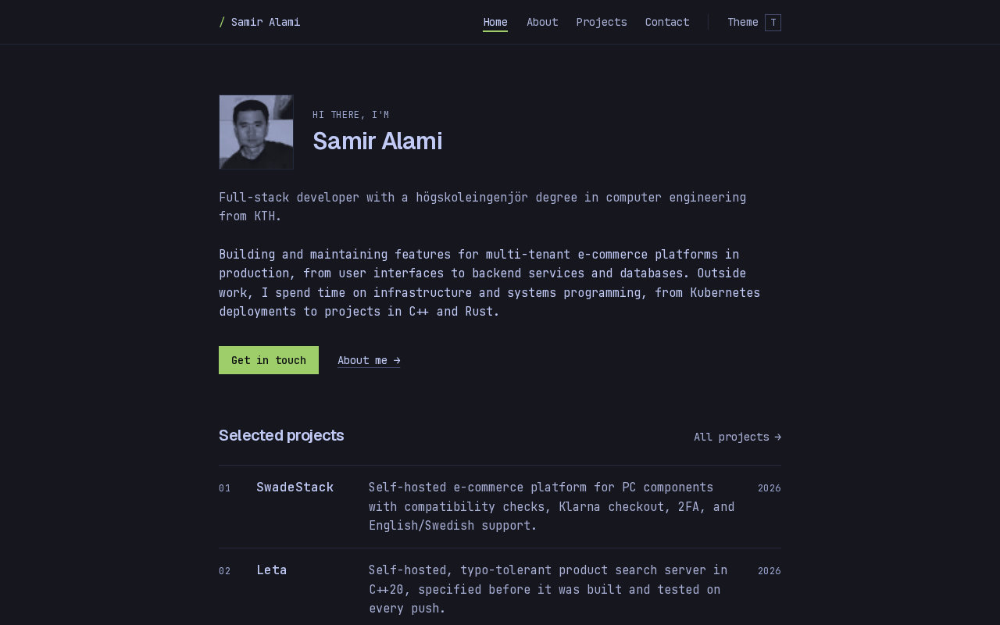

<div align="center">

# portfolio

**Samir's personal site.** Next.js, self-hosted on k3s, deployed by Argo CD.

[](https://github.com/Samir120/portfolio/actions/workflows/ci.yml)
[](https://samir.swadestack.com)
[](https://nextjs.org/docs)
[](#license)

**[samir.swadestack.com](https://samir.swadestack.com)**

</div>



**Contents** ·
[What this is](#what-this-is) ·
[Stack](#stack) ·
[Design](#design) ·
[Structure](#structure) ·
[Develop](#develop) ·
[Deploy](#deploy) ·
[Status](#status) ·
[Docs](#docs) ·
[License](#license)

## What this is

A classic, minimal developer portfolio: who I am, what I've built, and the
write-ups behind it. Five routes, no database, no CMS, every page
prerendered. The repository is also part of the portfolio — the
architecture, coding standards and release pipeline are written down in
[`docs/`](docs/) and followed.

## Stack

| Layer     | Choice                                                                                                                      |
| --------- | --------------------------------------------------------------------------------------------------------------------------- |
| Framework | Next.js (App Router, Server Components, Cache Components, `output: 'standalone'`)                                           |
| Language  | TypeScript, strict                                                                                                          |
| Styling   | Tailwind CSS v4, CSS custom-property themes                                                                                 |
| Content   | MDX in `content/`, typed metadata, `@next/mdx`                                                                              |
| Fonts     | Geist + JetBrains Mono via `next/font`                                                                                      |
| CI        | GitHub Actions — typecheck · lint · format · build · Playwright smoke test · Lighthouse budgets                             |
| Image     | Docker multi-stage, `linux/amd64`, pushed to GHCR                                                                           |
| Hosting   | k3s on a home server, Argo CD GitOps from [`swadestack-k8s`](https://github.com/Samir120/swadestack-k8s), Cloudflare tunnel |

## Design

Terminal-inspired and still: Geist and JetBrains Mono, no rounded corners,
hairline borders, and themes named after terminal colour schemes. Tokyo
Night is the default; press <kbd>T</kbd> to switch. Every colour is a
semantic token, so a theme is one block of CSS variables, and photos are
tinted in the theme's own colours. The full spec is
[`docs/02-design-system.md`](docs/02-design-system.md).

## Structure

```
app/          routes and Next.js file conventions only
components/   shared UI, one component per file
content/      MDX — projects
lib/          pure TypeScript — site facts, content loader, themes
public/       images
assets/       fonts for the generated Open Graph cards
tests/        Playwright smoke test
docs/         specification and ADRs
```

Details and the rules that keep it this way:
[`docs/03-architecture.md`](docs/03-architecture.md).

## Develop

Requires the Node version in `.node-version`.

```sh
npm ci
npm run dev        # http://localhost:3000
npm run check      # typecheck + lint + format + build — run before every commit
npm run test:e2e   # smoke test, after a build; needs `npx playwright install chromium`
```

## Deploy

Push to `main` → CI gates → image `ghcr.io/samir120/portfolio:<sha>` →
`newTag` bump in `swadestack-k8s` → Argo CD sync → live. Rollback is a
`git revert` in the GitOps repo. The whole path is in
[`docs/07-release-engineering.md`](docs/07-release-engineering.md).

## Status

Live at [samir.swadestack.com](https://samir.swadestack.com), tagged
`v1.0.0`. Every push to `main` deploys. What was built, in order, and what
may come next is in [`docs/06-roadmap.md`](docs/06-roadmap.md).

## Docs

|                                                                                                                                                                                                                                                                  |                                         |
| ---------------------------------------------------------------------------------------------------------------------------------------------------------------------------------------------------------------------------------------------------------------- | --------------------------------------- |
| [01 — Problem and scope](docs/01-problem-and-scope.md)                                                                                                                                                                                                           | why it exists, what v1 is and isn't     |
| [02 — Design system](docs/02-design-system.md)                                                                                                                                                                                                                   | tokens, type, layout, pages             |
| [03 — Architecture](docs/03-architecture.md)                                                                                                                                                                                                                     | layout, rendering, content pipeline     |
| [04 — Coding standards](docs/04-coding-standards.md)                                                                                                                                                                                                             | the rules                               |
| [05 — Quality and testing](docs/05-quality-and-testing.md)                                                                                                                                                                                                       | gates and budgets                       |
| [06 — Roadmap](docs/06-roadmap.md)                                                                                                                                                                                                                               | milestones and tasks                    |
| [07 — Release engineering](docs/07-release-engineering.md)                                                                                                                                                                                                       | CI, image, GitOps, Cloudflare           |
| [ADR-0001](docs/adr/0001-standalone-output.md) · [ADR-0002](docs/adr/0002-mdx-content-in-repo.md) · [ADR-0003](docs/adr/0003-css-variable-theming.md) · [ADR-0004](docs/adr/0004-cache-components.md) · [ADR-0005](docs/adr/0005-mdx-meta-validated-at-build.md) | decisions and the alternatives rejected |

## License

Code is MIT. Written content and images under `content/` and `public/` are
© Samir and not licensed for reuse. The fonts in `assets/fonts/` are under
the SIL Open Font License (`OFL.txt` beside them).
